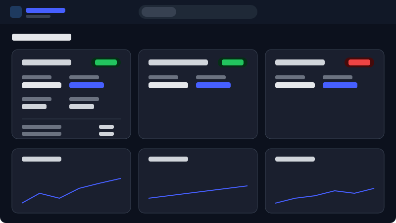
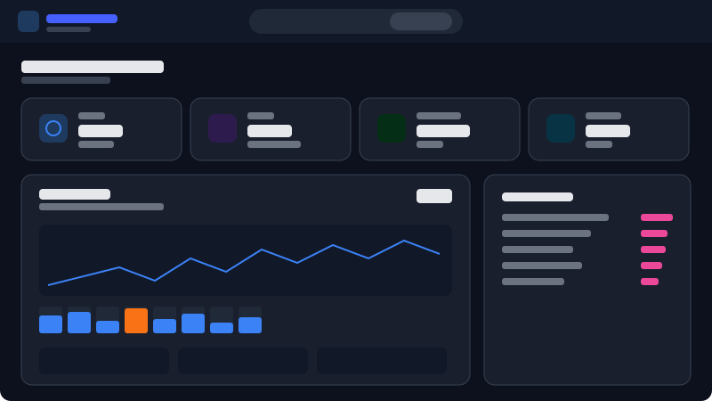

# TrackBoard

Dashboard personnel pour suivre les stats de trackers torrent privés et monitorer son hardware en temps réel.

<p align="center">
  
</p>

<p align="center">
  
</p>

## Fonctionnalités

**Statistiques Trackers**
- Ratio, buffer, upload/download, bonus points par tracker
- Graphiques d'historique sur 30 jours
- Support UNIT3D (Generation-Free, TheOldSchool, Gemini), Torr9
- Liens rapides vers les boutiques bonus
- Scraping automatique à 8h/14h/20h (Europe/Paris)

**Monitoring Hardware (PC local)**
- CPU : charge, température, puissance, fréquence, ventilateur, charge par cœur
- GPU : charge, température, VRAM, puissance, ventilateur (NVIDIA via `nvidia-smi`)
- RAM : utilisation en temps réel
- Stockage : espace disque, températures HDD/NVMe (LibreHardwareMonitor WMI)
- Réseau : upload/download en temps réel
- Uptime système

**Services média (optionnels)**
- Vue agrégée Plex / Radarr / Sonarr / Tautulli (URLs configurables, accessibles depuis le backend)

## Architecture

```
┌─ PC Local ─────────┐                                ┌─ VPS ───────────────────────┐
│                    │                                │                             │
│  hw-agent (auto    │ ──── WSS ────────────────────► │  Backend FastAPI            │
│  start Win Task    │                                │   ├── PostgreSQL            │
│  Scheduler SYSTEM) │                                │   ├── Scrapers (Playwright) │
│                    │                                │   └── Hardware WS hub       │
│  Plex / Radarr /   │                                │                             │
│  Sonarr / Tautulli │ ◄── HTTP via Cloudflare ────── │  Backend (media routes)     │
│  (LAN local)       │      Tunnel                    │                             │
│                    │                                │  Frontend (Next.js)         │
└────────────────────┘                                │                             │
                                                      │  Reverse proxy host         │
       navigateur ──── HTTPS ──────────────────────► │   (nginx/caddy, un vhost)   │
                                                      │   ├── /auth /api /scrapers  │
                                                      │   │   /hardware /media/     │
                                                      │   │   /health    -> :8000   │
                                                      │   └── le reste   -> :3000   │
                                                      └─────────────────────────────┘
```

Le frontend et le backend sont servis sous **une seule adresse** (« même origine ») par un reverse proxy installé sur l'hôte (nginx ou Caddy, pas dans le compose) : les chemins de l'API vont au backend, tout le reste au frontend. Le frontend est alors construit avec `NEXT_PUBLIC_API_URL` vide (valeur par défaut du compose). Pour servir le backend sur un autre domaine, renseigner `NEXT_PUBLIC_API_URL` avant de construire le frontend.

| Composant | Stack |
|-----------|-------|
| **Backend** | FastAPI, async SQLAlchemy, JWT, WebSocket |
| **Frontend** | Next.js 16, Tailwind CSS 4, ApexCharts |
| **DB** | PostgreSQL 16 |
| **Scrapers** | Playwright headless Chromium |
| **HW Agent** | Python (psutil, nvidia-smi, LibreHardwareMonitor via WMI) |
| **Reverse proxy** | nginx ou Caddy installé sur le host (gère HTTPS et le multi-vhosts) |
| **Infra** | Docker Compose |

## Prérequis

- VPS avec Docker, Docker Compose
- Reverse proxy installé sur l'hôte (nginx ou Caddy) avec un certificat pour l'adresse du dashboard
- Une adresse pointant vers le VPS ; de préférence réservée à un réseau privé (VPN de type WireGuard ou Tailscale, filtrage `allow`/`deny` dans le vhost) plutôt qu'ouverte sur Internet
- PC local pour l'agent hardware (Windows recommandé pour les températures via LibreHardwareMonitor)
- Comptes sur les trackers privés à monitorer

## Installation

### 1. Cloner

```bash
git clone <repo-url> trackboard
cd trackboard
```

### 2. Configurer

```bash
cp .env.example .env
nano .env  # remplir DOMAIN, JWT_SECRET, ADMIN_PASSWORD, HW_AGENT_TOKEN, credentials trackers...
```

Variables critiques :

| Variable | Description |
|----------|-------------|
| `DOMAIN` | Votre domaine de base (ex: `example.com`), utilisé pour les origines CORS du backend |
| `NEXT_PUBLIC_API_URL` | Vide (défaut) en « même origine » ; URL du backend s'il est servi sur un autre domaine (lue à la construction du frontend) |
| `JWT_SECRET` | Clé JWT (générer avec `openssl rand -hex 32`) |
| `ADMIN_PASSWORD` | Mot de passe admin du dashboard |
| `HW_AGENT_TOKEN` | Token de l'agent hardware (`openssl rand -hex 16`) |
| `SESSION_SYNC_TOKEN` | Facultatif : jeton du poste qui renouvelle la session C411 (`openssl rand -hex 32`), accepté sur `POST /scrapers/session/{tracker}` seulement |
| `DATABASE_URL` | URL PostgreSQL (cohérente avec POSTGRES_*) |
| `POSTGRES_PASSWORD` | Mot de passe Postgres |
| `TRACKER_USERNAME` | Pseudo affiché dans les liens shop bonus |
| `GF_USER/PASS/USERNAME` | Identifiants Generation-Free |
| `TOS_USER/PASS/USERNAME` | Identifiants TheOldSchool |
| `GEMINI_USER/PASS/USERNAME` | Identifiants Gemini Tracker |

### 3. Configurer le reverse proxy host

Exemple nginx en « même origine » (`/etc/nginx/sites-available/trackboard`) :

```nginx
# Journal sans la chaîne de requête : les WebSocket portent leur jeton dans l'URL
log_format trackboard_sans_requete '$remote_addr - [$time_local] "$request_method $uri $server_protocol" '
                                   '$status $body_bytes_sent "$http_user_agent"';

map $http_upgrade $trackboard_connexion {
    default upgrade;
    ''      close;
}

server {
    server_name dash.example.com;
    listen 443 ssl;
    # ... certificat (certbot --nginx, ou celui du VPN)

    # Accès réservé à un réseau privé (exemple : plage d'adresses du VPN)
    # allow 10.0.0.0/8;
    # deny  all;

    access_log /var/log/nginx/trackboard.access.log trackboard_sans_requete;

    # API FastAPI, WebSocket /hardware/ws/agent et /hardware/ws/client compris
    location ~ ^/(auth|api|scrapers|hardware|media|health)(/|$) {
        proxy_pass http://127.0.0.1:8000;
        proxy_http_version 1.1;
        proxy_set_header Host $host;
        proxy_set_header X-Real-IP $remote_addr;
        proxy_set_header X-Forwarded-For $proxy_add_x_forwarded_for;
        proxy_set_header X-Forwarded-Proto $scheme;
        proxy_set_header Upgrade $http_upgrade;
        proxy_set_header Connection $trackboard_connexion;
        proxy_read_timeout 86400;     # WebSocket de longue durée
    }

    # /media (sans barre finale) est une page du frontend, pas l'API /media/...
    location = /media {
        proxy_pass http://127.0.0.1:3000;
        proxy_http_version 1.1;
        proxy_set_header Host $host;
        proxy_set_header X-Forwarded-Proto $scheme;
    }

    # Frontend Next.js
    location / {
        proxy_pass http://127.0.0.1:3000;
        proxy_http_version 1.1;
        proxy_set_header Host $host;
        proxy_set_header X-Real-IP $remote_addr;
        proxy_set_header X-Forwarded-For $proxy_add_x_forwarded_for;
        proxy_set_header X-Forwarded-Proto $scheme;
    }
}
```

### 4. Déployer

```bash
docker compose up -d
docker compose logs -f
```

Les containers exposent leurs ports sur `127.0.0.1` uniquement ; seul le reverse proxy de l'hôte les sert. Le backend est plafonné à 1 500 Mio de mémoire, sans swap (`mem_limit` dans le compose) : un emballement de Chromium reste confiné au backend au lieu d'affamer les autres services de l'hôte.

### 5. Lancer l'agent hardware (PC local)

**Setup automatique recommandé** : utiliser le script PowerShell d'installation Task Scheduler (auto-start au boot, restart si crash, tourne en compte SYSTEM) :

```powershell
# Sur le PC local, en PowerShell admin :
cd hw-agent
powershell.exe -ExecutionPolicy Bypass -File ..\scripts\install-hw-agent-task.ps1
```

**Setup manuel** :

```bash
cd hw-agent
cp .env.example .env
# Configurer WS_URL=wss://<adresse du dashboard>/hardware/ws/agent
# et HW_AGENT_TOKEN (même valeur que dans le .env du serveur)

python -m venv venv
venv\Scripts\activate          # Windows
# source venv/bin/activate     # Linux/Mac
pip install -r requirements.txt
python agent.py
```

L'agent envoie les stats hardware toutes les 2 secondes via WebSocket.

### 6. Première connexion aux trackers (cookies)

Le scraper utilise des cookies persistants pour éviter de re-login à chaque scrape (et pour passer les captchas anti-bot type Gemini). Capture les cookies depuis le VPS :

```bash
docker compose exec backend python capture_cookies.py "GF-FREE" "https://generation-free.org/login"
```

Un Chromium s'ouvre, login manuellement, ferme l'onglet — les cookies sont sauvegardés dans le volume `cookies-data`.

#### Trackers à connexion manuelle (C411, Ygg)

La connexion de ces deux sites passe par un captcha : TrackBoard ne s'y connecte jamais seul et relit la session ouverte à la main. Pour la déposer ou la renouveler, sans SSH :

1. Se connecter au site dans son navigateur.
2. F12, onglet Application (Chrome) ou Stockage (Firefox), Cookies : copier la valeur du cookie de session (`__Host-c411_session` pour C411, `__ygg_sess` pour Ygg).
3. Dans TrackBoard, carte du tracker, « Reconnecter » (ou « Renouveler la session ») : coller la valeur, valider.

Le backend (`POST /scrapers/session/{tracker}`, jeton de l'interface ou `SESSION_SYNC_TOKEN`) accepte deux corps : `{"valeur": "..."}` (le cookie de session seul) ou `{"storage_state": {...}}` (l'état complet rendu par `context.storage_state()` de Playwright, qui garde aussi les cookies secondaires du site ; les autres domaines et les cookies de Cloudflare sont écartés). Il écrit le fichier de cookies au format `storage_state` de Playwright et lance un relevé de contrôle ; la réponse dit si le site accepte la session. La valeur n'est ni journalisée ni renvoyée.

La session C411 dure 7 jours fixes : un rappel Discord part au premier relevé à moins de 36 h de l'échéance. Pour ne plus copier le cookie à la main, [`session-sync/`](session-sync/README.md) installe sur le PC Windows une tâche planifiée (compte utilisateur, sans privilège) qui ouvre la page de connexion tous les 6 jours et dépose le `storage_state` une fois la connexion faite à la main ; le captcha n'est jamais contourné. Celle d'Ygg est prolongée par le site à chaque relevé.

### 7. Alertes Discord

- Relevé en échec : une alerte au 3e échec consécutif, un rappel par 24 h tant que la panne dure, puis un message au rétablissement. Session manuelle expirée : message dédié avec la marche à suivre.
- Avertissements actifs (hit and run en cours) sur un UNIT3D : une alerte quand le compteur augmente (`@here` à partir de 2), puis un rappel sans `@here` par 24 h tant qu'il en reste 2 ou plus. Le message liste les torrents concernés (les remettre en partage lève l'avertissement) et, si la boutique du tracker vend un rachat, son lien direct et son prix face au solde.
- `TRACKBOARD_URL` (facultatif) : adresse de l'interface citée dans ces messages.

## Mode démo (sans backend)

Pour prévisualiser l'interface avec des données fictives :

```bash
cd frontend
NEXT_PUBLIC_DEMO=true npm run dev
```

Pour publier une démo en ligne (ex: Vercel), utiliser un nom de projet **anonyme** afin de ne pas exposer d'identité dans l'URL générée.

## Développement local

```bash
# Backend + DB en Docker
docker compose -f docker-compose.dev.yml up -d

# Frontend en local (dans un autre terminal)
cd frontend
cp .env.local.example .env.local   # garde NEXT_PUBLIC_API_URL=http://localhost:8000
npm install
npm run dev
```

Le backend dev tourne sur `http://localhost:8000` (sans HTTPS, sans reverse proxy), le frontend sur `http://localhost:3000`.

## Migrations de schéma (Alembic)

Alembic est configuré pour gérer les changements de schéma sans perdre l'historique. Voir `backend/alembic/README.md` pour la procédure de bootstrap et le workflow.

Tant qu'Alembic n'est pas amorcé (aucune révision, dossier absent de l'image), les tables sont créées par `create_all` au démarrage et les colonnes facultatives ajoutées depuis passent par la liste `COLONNES_AJOUTEES` de `backend/app/db/database.py` (`ALTER TABLE ... ADD COLUMN` rejoué sans effet à chaque démarrage).

## Structure du projet

```
trackboard/
├── backend/                    # API FastAPI
│   ├── app/
│   │   ├── main.py             # Point d'entrée, CORS, lifespan
│   │   ├── config.py           # Pydantic Settings
│   │   ├── health.py           # Healthchecks honnêtes (DB, scheduler, agent...)
│   │   ├── logging_config.py
│   │   ├── auth/               # JWT + rate limiting
│   │   ├── api/                # Routes REST (stats, history)
│   │   ├── hardware/           # WebSocket hub hardware
│   │   ├── media/              # Plex / Radarr / Sonarr / Tautulli
│   │   ├── scrapers/           # Playwright + scheduler
│   │   └── db/                 # SQLAlchemy async
│   ├── alembic/                # Migrations DB
│   ├── tests/
│   ├── capture_cookies.py      # Capture manuelle des cookies trackers
│   ├── Dockerfile              # Production
│   ├── Dockerfile.dev          # Hot reload
│   └── requirements.txt
├── frontend/                   # Next.js
│   ├── src/
│   │   ├── app/                # Pages routées
│   │   ├── components/         # UI (tracker, hardware, common)
│   │   ├── context/            # Auth, Theme, Toast
│   │   ├── hooks/              # useHardwareStats
│   │   └── lib/                # Client API + données démo
│   └── Dockerfile
├── hw-agent/                   # Agent hardware (PC local)
│   ├── agent.py                # psutil + nvidia-smi + LHM WMI
│   └── requirements.txt
├── session-sync/               # Dépôt de la session C411 depuis le PC local
│   ├── session_sync.py         # storage_state ou cookie -> POST /scrapers/session
│   └── README.md
├── scripts/                    # Outillage operationnel
│   ├── diagnose.sh                  # Diag complet du VPS (SSH)
│   ├── install-hw-agent-task.ps1    # Auto-start hw-agent en Task Scheduler Win
│   ├── install-session-sync-task.ps1 # Tâche session-sync (compte utilisateur, sans privilège)
│   └── fix-cloudflare-tunnel.ps1    # Repare cloudflared service config path
├── docker-compose.yml          # Production (DB + back + front)
├── docker-compose.dev.yml      # Dev local (DB + back hot reload)
├── deploy_to_ovh.sh            # Helper rsync deploy
└── .env.example
```

## Sécurité

- JWT sur toutes les routes de données et WebSocket ; seules `/`, `/health`, `/auth/login` et `/auth/logout` répondent sans jeton (vérifié par `tests/test_securite.py`)
- Documentation interactive (`/docs`, `/redoc`, `/openapi.json`) coupée par défaut, `DOCS_ENABLED=true` en développement seulement
- Rate limiting sur `/auth/login` (5 tentatives/min/IP)
- Conteneurs DB/back/front exposés uniquement sur `127.0.0.1` (le reverse proxy host fait la passerelle publique)
- Agent hardware authentifié par token séparé
- Dépôt de session depuis un autre poste : jeton dédié `SESSION_SYNC_TOKEN`, refusé partout ailleurs que sur `POST /scrapers/session/{tracker}`
- CORS configuré par domaine (pas de wildcard)
- Aucun secret dans le code source (tout via `.env`, déjà gitignored)
- `/health` public minimal, `/health/full` derrière auth pour les détails techniques

## Licence

MIT
